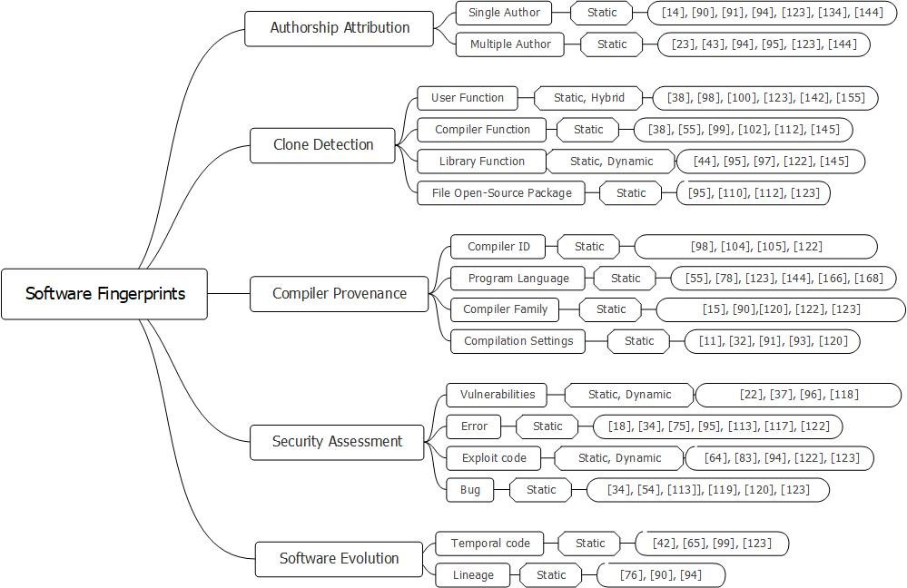

# Binary-Code-Analysis

A systematic review of forensic techniques for vulnerability detection and anti-evasion in binary code.

[](https://doi.org/10.1109/access.2025.3610616)
[](https://github.com/haseebjaved123/BinaryCode_Access_2025)



## What it is

A systematic review of forensic techniques for vulnerability detection and anti-evasion in binary code. Venue: IEEE Access, vol. 13, pp. 167139–167164, 2025.

## Why it matters

The paper is part of the published record on applied machine learning. This repository records the bibliographic facts and the figure used on the project site. It does not add unpublished measurements.

## Citation

```bibtex
@article{javed2025binary,
  title={Binary Code Analysis for Cybersecurity: A Systematic Review of Forensic Techniques in Vulnerability Detection and Anti-Evasion Strategies},
  author={Javed, Haseeb and Ali, Farman and Shah, Babar and Kwak, Daehan},
  journal={IEEE Access},
  year={2025},
  doi={10.1109/access.2025.3610616}
}
```

## License

MIT for notes and helper code in this repository. The article remains with its publisher.
